# Arepa Express: API Gateway y RabbitMQ en Azure

DOSW 1, semana 14. Sebastián Granados.

Backend de una arepería con cuatro microservicios en Spring Boot. Las llamadas HTTP del cliente entran por un API Gateway (Azure API Management) y, cuando se crea un pedido, `pedidos-service` publica un evento en RabbitMQ para que cocina y notificaciones se enteren sin que nadie se quede esperando.

| Servicio | Repositorio |
|---|---|
| menu-service | https://github.com/Sebastian-Granados1456/menu-service |
| pedidos-service | https://github.com/Sebastian-Granados1456/pedidos-service |
| cocina-service | https://github.com/Sebastian-Granados1456/cocina-service |
| notificaciones-service | https://github.com/Sebastian-Granados1456/notificaciones-service |

```
Cliente ──HTTP──► API Gateway (APIM) ──► menu-service
                                     └─► pedidos-service ──evento──► RabbitMQ (arepas.eventos)
                                                                        ├─► cocina.pedidos ──► cocina-service
                                                                        └─► notificaciones.pedidos ──► notificaciones-service
```

## Cambios respecto a la guía

Por restricciones de la suscripción Azure for Students:

- **Región:** la política de la suscripción no permite `eastus`, así que todo quedó en `northcentralus`.
- **Imágenes:** Azure for Students no permite ACR Tasks (lo que usa `az containerapp up --source`). Construí cada imagen con Docker en mi equipo, la subí al Azure Container Registry y desplegué con la imagen.
- **Spring Boot 4:** en lugar de `Jackson2JsonMessageConverter` (obsoleto en esa versión) usé `JacksonJsonMessageConverter`.
- **Logs:** el comando de logs de la CLI falló por un error de la extensión preview, así que revisé los logs desde la Secuencia de registro del portal.

## Sección 1: API Gateway

### Servicios

`menu-service` expone `GET /menu`. `pedidos-service` expone `POST /pedidos` y está en arquitectura hexagonal: modelo y puertos en `domain`, el caso de uso `CrearPedidoUseCaseImpl` en `application` y el controlador REST en `infrastructure`. El controlador depende de la interfaz `CrearPedidoUseCase`, no de la implementación. Los dos están desplegados en Azure Container Apps, en el ambiente `arepas-env`.

### Gateway con API Management

El gateway `arepas-gw-kamilog` (plan Consumption) es la única puerta de entrada: el cliente solo conoce `https://arepas-gw-kamilog.azure-api.net` y el gateway enruta por prefijo, `/menu-api` hacia menu-service y `/pedidos-api` hacia pedidos-service. Solo pasan las operaciones registradas (`GET /menu` y `POST /pedidos`).

### Llave de suscripción

Las APIs exigen una llave de suscripción. Sin la llave el gateway responde 401 sin reenviar la petición al servicio. Con la llave en el header `Ocp-Apim-Subscription-Key`, el menú responde 200 y el pedido 201.

Sin llave, 401:

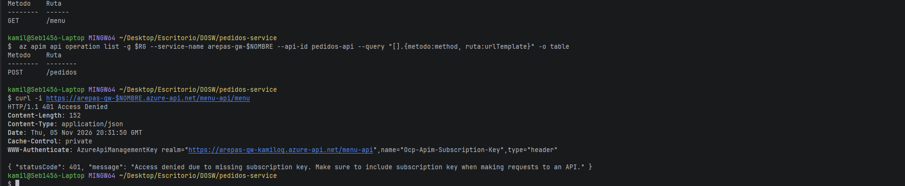

Con llave, 200:

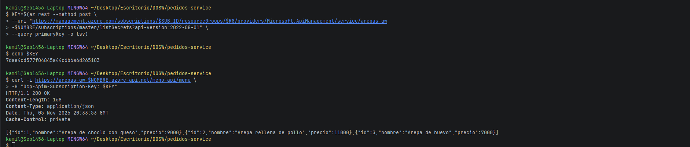

Pedido por el gateway, 201:

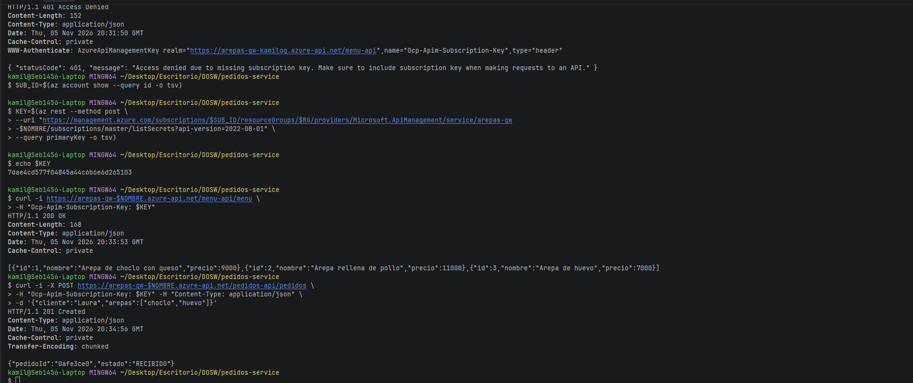

### Política de salida

En Menu API hay una política outbound que agrega el header `X-Arepa-Gateway: DOSW Company` a cada respuesta. El código de menu-service no cambió: el header lo pone el gateway.

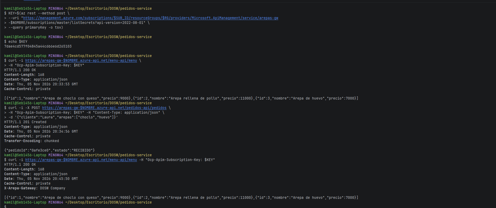

## Sección 2: Eventos con RabbitMQ

### Broker

RabbitMQ (`rabbitmq:3-management`) corre en Azure Container Instances, con el puerto 5672 para los servicios y el 15672 para el panel. Los servicios reciben host, usuario y clave como variables de entorno.

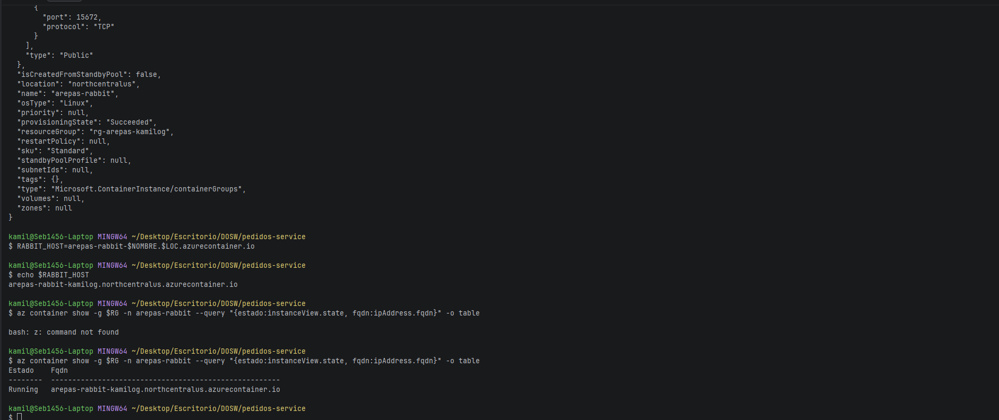

### pedidos-service publica

Publicar el evento es un puerto de salida (`PedidoEventPublisher`) en el dominio, y `RabbitPedidoEventPublisherImpl` es el adaptador que lo implementa con `RabbitTemplate`. Al crear un pedido, el caso de uso publica un `PedidoCreadoEvent` en el exchange topic `arepas.eventos` con la routing key `pedido.creado` y responde de inmediato con `RECIBIDO`. El caso de uso no sabe que existe RabbitMQ.

### Consumidores

- `cocina-service`: cola `cocina.pedidos`, binding `pedido.*`. Por cada pedido escribe "Preparando", espera 3 segundos y escribe "listo".
- `notificaciones-service`: cola `notificaciones.pedidos`, binding `pedido.creado`. Escribe la confirmación para el cliente.

Las colas son durables. Los consumidores tienen ingress interno, porque no reciben HTTP de afuera, y una réplica mínima siempre encendida para que siempre haya alguien leyendo las colas.

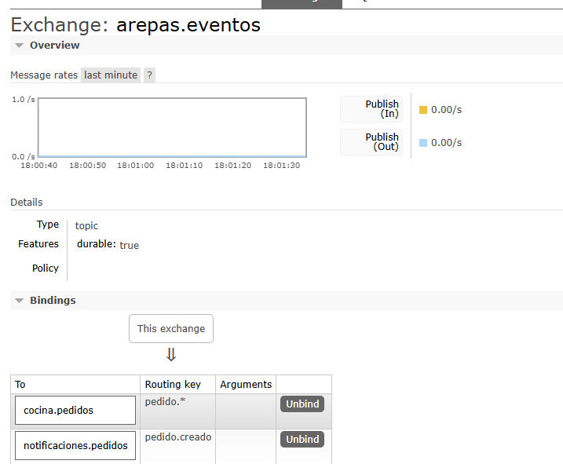

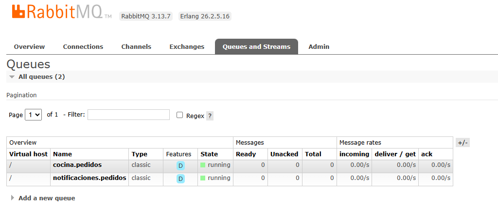

### Prueba de punta a punta

Un pedido para Andres por el gateway respondió de inmediato con `RECIBIDO`, y en el mismo segundo cocina y notificaciones recibieron el pedido `85c2db9e`.

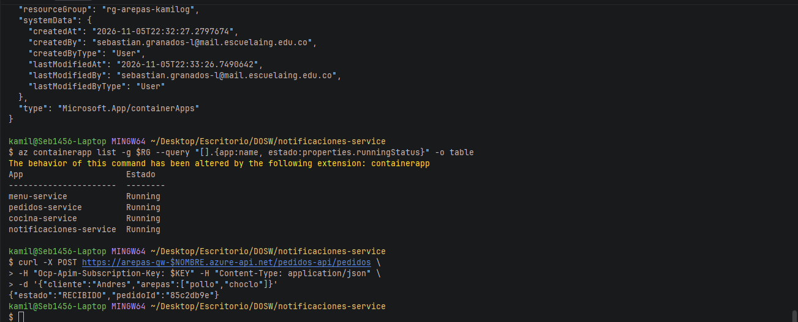

Logs de cocina:

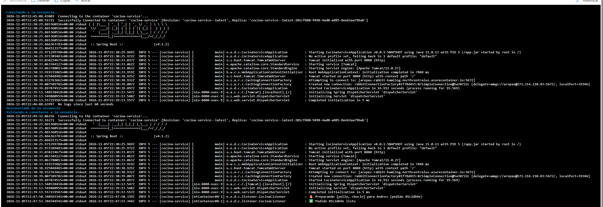

Logs de notificaciones:

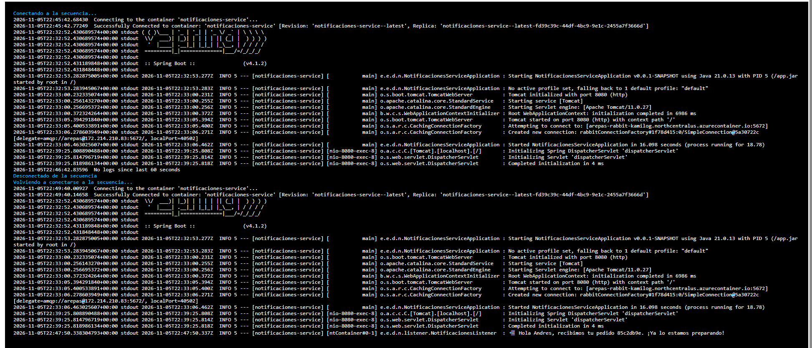

## Experimentos

### Uno a muchos

El pedido llegó a cocina y a notificaciones porque cada uno tiene su propia cola unida al mismo exchange, y el exchange entrega una copia a cada cola que coincide con la routing key. Si los dos leyeran de la misma cola, cada pedido le llegaría solo a uno: la cola reparte los mensajes entre sus consumidores, no los copia.

### Cola de trabajo

Con cocina en 2 réplicas, `cocina.pedidos` mostró 2 consumidores. De 6 pedidos seguidos, una réplica preparó los de Cliente1, 3 y 5 y la otra los de Cliente2, 4 y 6. Ningún pedido se preparó dos veces, y en paralelo los seis quedaron listos en unos 9 segundos en lugar de 18. Notificaciones, con su propia cola, recibió los seis.

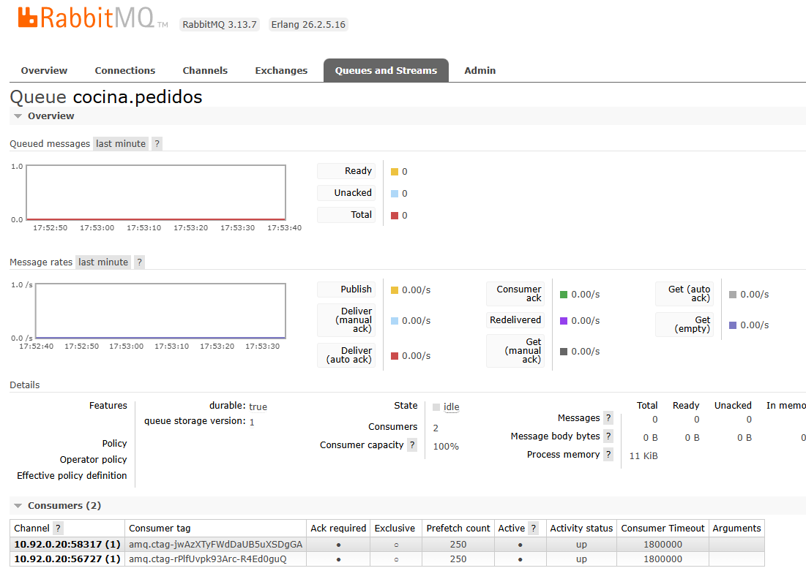

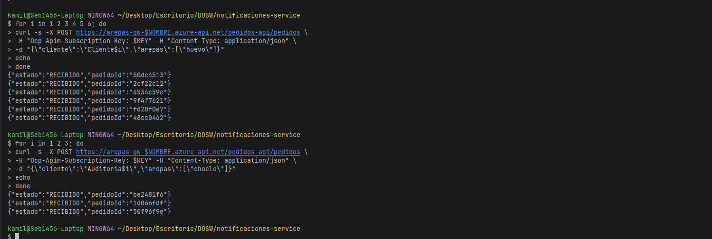

Réplica 1:

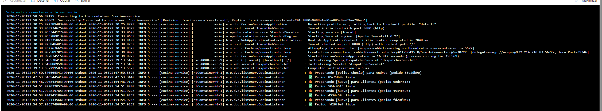

Réplica 2:

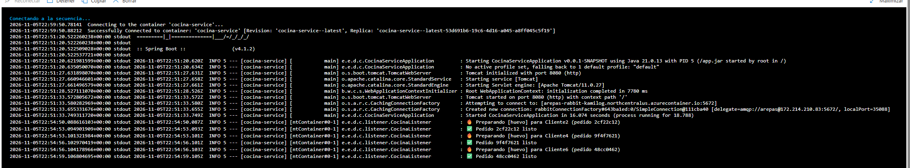

### Los mensajes esperan

Creé la cola `auditoria.pedidos` con el binding `pedido.#` y mandé 3 pedidos. Cocina y notificaciones los consumieron, pero `auditoria.pedidos` quedó con 3 mensajes en Ready porque no tiene consumidores. Los mensajes se guardan hasta que alguien los lea; por eso un servicio caído no pierde eventos.

`pedido.*` acepta exactamente una palabra después del punto, `pedido.#` acepta cualquier cantidad y `pedido.creado` solo ese evento.

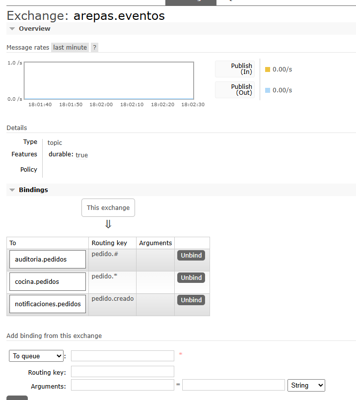

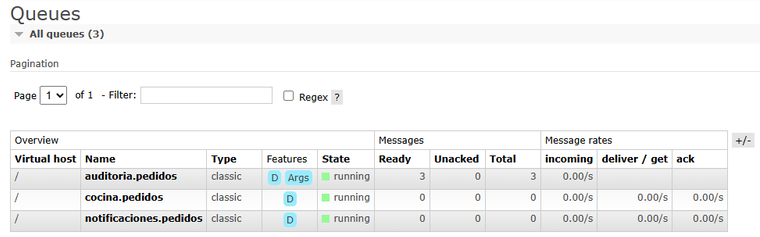

## Preguntas

**¿Qué pasa con los pedidos si cocina-service se cae por 5 minutos?**
No se pierden. pedidos-service sigue publicando, porque no depende de cocina. Los eventos se acumulan en la cola durable `cocina.pedidos` y cocina los procesa cuando vuelve. Notificaciones sigue normal porque tiene su propia cola.

**¿Por qué el gateway devuelve 401 sin que el servicio se entere?**
Porque la llave se valida en el gateway antes de reenviar la petición. Si falta o no es válida, el gateway responde él mismo y la petición nunca llega al servicio.

**¿Dónde validarías el token de un usuario: en el gateway o en cada microservicio?**
La autenticación (que el token sea real y no haya vencido) en el gateway: es un solo punto, rechaza temprano y no se repite código. Los permisos del negocio, como que un cliente solo vea sus propios pedidos, en cada microservicio, porque solo el servicio conoce esas reglas.

**¿Qué pasa si el pedido se crea pero el evento no se alcanza a publicar?**
El sistema queda inconsistente: el cliente cree que su pedido entró, pero cocina y notificaciones nunca se enteran. Se soluciona con reintentos y confirmaciones del broker, o con el patrón outbox: guardar el pedido y el evento en la misma transacción y publicar el evento después.

**¿Cuándo usarías una cola y cuándo un tópico en Style Radar?**
Un tópico cuando varios servicios deben enterarse del mismo hecho, por ejemplo un cambio de inventario de una prenda en una sede: catálogo, geolocalización y notificaciones reciben cada uno su copia. Una cola de trabajo cuando una tarea la debe hacer un solo trabajador y conviene repartir la carga, por ejemplo generar la imagen del probador virtual.
